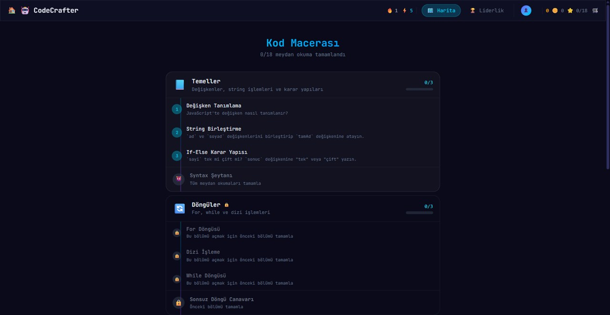
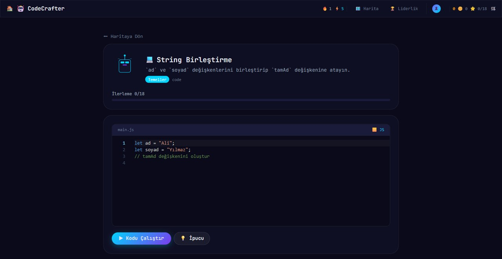

# CodeCrafter

A programming course that plays like a role-playing game. You walk a character across a map, every node is a coding challenge, and each chapter ends with a boss that only falls to code that actually runs.

Interface is Turkish. Challenge content exists for 23 languages, from Python and C to Haskell and Julia.

**Live:** [codecrafter-chi.vercel.app](https://codecrafter-chi.vercel.app)

 

## How it plays

Six chapters — **basics, loops, functions, arrays, objects, es6** — each with three challenges and a three-stage boss. A chapter stays locked until the previous boss is beaten.

- **Map** — a chapter list with a vertical path, one node per challenge; the next chapter stays locked until the previous boss falls
- **Editor** — Monaco, syntax highlighting per language
- **Challenges** — fill in the body, answer a quiz, or drag statements into order
- **Bosses** — three consecutive stages, health drains on every failed run
- **Skill tree** — level ups grant points for hints, extra time and health
- **Story** — dialogue scenes between chapters

Each challenge ships a starter file, a test script and a hint. The test script runs against your code and reports the first assertion that fails, so the error you see is the one your code produced.

## Running submitted code

| Route | |
|---|---|
| `POST /api/run` | JavaScript, in a Node `vm` context, 2 s timeout |
| `POST /api/run/python` | Python, written to a temp file and executed |
| `POST /api/run/java` | Java, same shape |

Body is `{ "code": "...", "tests": "..." }`; the response is `{ passed, error }`. The route appends the tests to the submitted code and looks for the `ALL_TESTS_PASSED` marker on stdout.

## The rest of it

- **Accounts** — register and log in, progress syncs to the server
- **Leaderboard** — ranked by coins
- **Economy** — coins, a shop, rewarded video and interstitial ads, Gumroad checkout, withdrawal requests
- **Storage** — Turso (libSQL) in production, a local SQLite file in development
- **Android** — Capacitor shell, APK built by GitHub Actions on every push

## Running locally

```bash
npm install
cp .env.example .env.local
npm run dev
```

Without `TURSO_DATABASE_URL` the app falls back to `data/codecrafter.db`. Ad slot IDs and the Gumroad token are optional; leave them empty and those surfaces stay hidden.

## Stack

Next.js · React · TypeScript · Monaco · Capacitor · Turso · Tailwind

## Known limitations

The three execution routes run submitted code on the server process. A Node `vm` context is not a security boundary and a child process is not one either, so this deployment is meant for a trusted audience. Putting a container or a third-party execution service behind those routes is the work that remains before it can be opened to the public.

## License

MIT — see [LICENSE](LICENSE).
